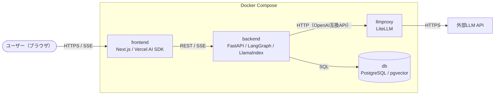
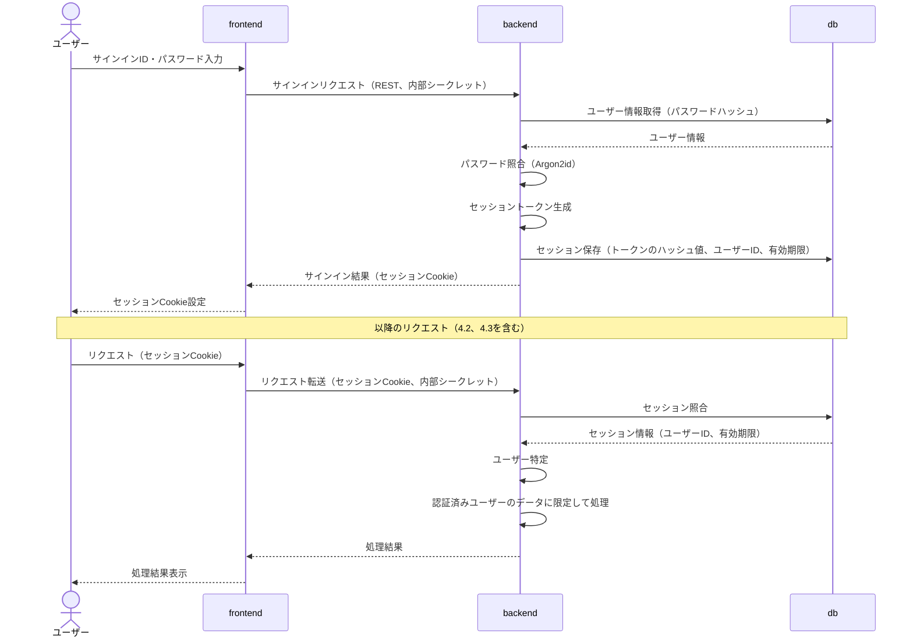
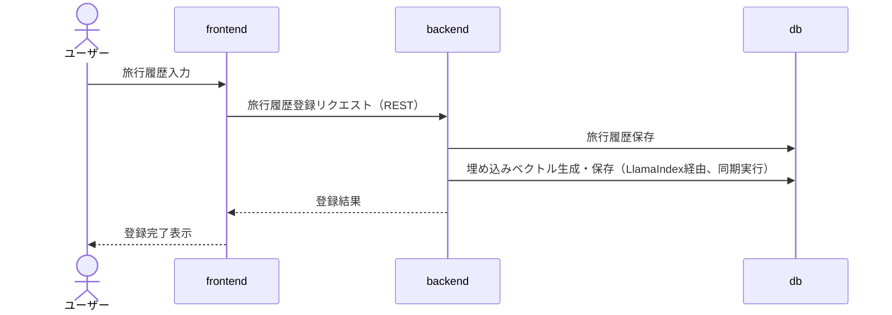
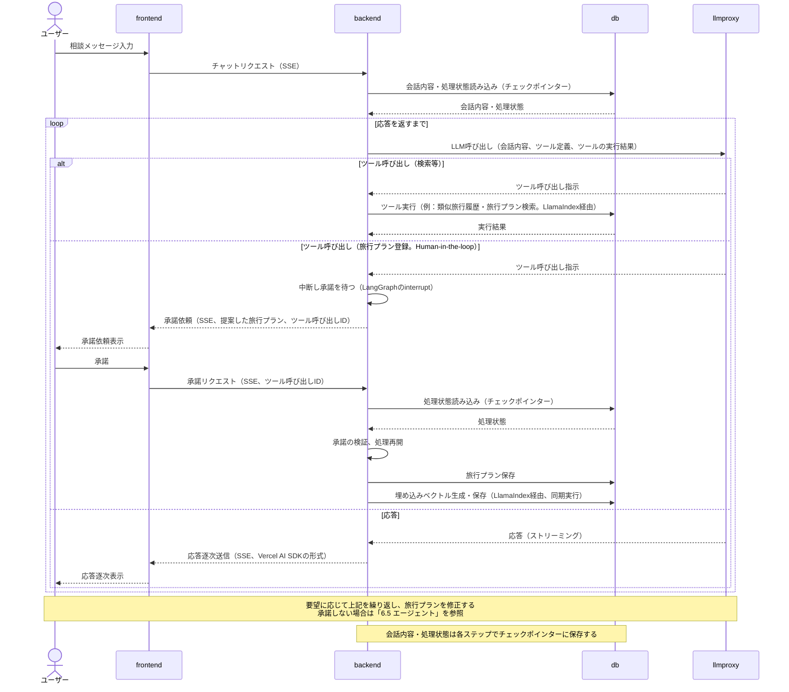

# アーキテクチャ

## 1 システム構成図

## 2 コンポーネント一覧

以降、各コンポーネントはコンテナ名で表記する。

| コンポーネント | コンテナ | 責務 | 依存先 |
|---|---|---|---|
| フロントエンド | frontend | ・画面表示・入力受付（旅行履歴、旅行プラン、チャット、会話履歴、アカウント登録・サインイン・サインアウト・パスワード変更・アカウント削除） ・ストリーミング応答の逐次表示 ・backendへの転送・呼び出し（サーバー側） | backend |
| バックエンド | backend | ・Web API（REST・SSE） ・リクエスト元の検証（内部シークレット） ・ユーザー認証（パスワード照合、セッションの発行・検証・無効化） ・アカウント管理（登録・パスワード変更・削除） ・旅行履歴の登録・参照・編集・削除 ・旅行プランの登録・参照・編集・削除、旅行履歴への移行 ・埋め込みベクトルの生成 ・RAG検索 ・エージェント処理（ツールの選択・実行、旅行プランの提案・修正、承諾待ち（Human-in-the-loop）） ・LLM呼び出し ・会話履歴の保存・参照・削除 | db、llmproxy |
| LLMプロキシ | llmproxy | ・LLM API呼び出しの集約 ・利用モデルの切替 | 外部LLM API |
| データベース | db | ・アプリケーションデータの永続化 ・ベクトルの保存・類似度検索 | - |

各コンポーネントには上記以外の処理を実装しない。

## 3 主要データ

| データ | 内容 | 管理 | 格納先DB | ユーザー単位 |
|---|---|---|---|---|
| ユーザー | サインインID、パスワードハッシュ | アプリ側のテーブル（Alembic） | app_tx | - |
| セッション | トークンのハッシュ値、ユーザーID、有効期限 | アプリ側のテーブル（Alembic） | app_tx | ○ |
| 旅行履歴 | 旅行の登録内容、ユーザーID、埋め込みベクトルの生成状態 | アプリ側のテーブル（Alembic） | app_tx | ○ |
| 旅行プラン | 承諾された旅行プランの内容、ユーザーID、作成元の会話ID、登録時のツール呼び出しID、埋め込みベクトルの生成状態 | アプリ側のテーブル（Alembic） | app_tx | ○ |
| 埋め込みベクトル | ベクトル、種別（旅行履歴・旅行プラン）、ユーザーID、生成モデル | LlamaIndex（pgvector） | app_rag | ○ |
| 会話メタ情報 | 会話ID、ユーザーID、タイトル、作成日時 | アプリ側のテーブル（Alembic） | app_tx | ○ |
| 会話内容・処理状態 | メッセージ、エージェントの処理状態 | LangGraphのチェックポインター | app_tx | ○ |

- 格納先DB：dbコンテナ内のDB。app_txはアプリケーション用、app_ragはRAG用（pgvector有効）。
- 提案・修正中の旅行プランは処理状態に含まれ、承諾後に旅行プランとして保存する。
- 旅行が終わった旅行プランは旅行履歴に移行し、削除する（移行のきっかけ・項目の対応は未定）。

## 4 主要処理フロー

### 4.1 サインイン・認証済みリクエスト

### 4.2 旅行履歴の登録

### 4.3 旅行プランの相談（チャット）

## 5 通信方式

TBD
<!-- 記述予定内容：
- 各経路（ブラウザ→frontend、frontend→backend、backend→llmproxy、backend→db）のプロトコル・データ形式
- backendのSSE出力形式（採用するVercel AI SDKのバージョンとプロトコル）
- 承諾待ち（LangGraphのinterrupt）・再開の、Vercel AI SDKの形式での表現
- 認証情報の受け渡し（内部シークレットのヘッダー名、セッションCookie名）
- エラーレスポンスの形式
-->

## 6 アーキテクチャ方針・制約

### 6.1 通信経路

- ブラウザ→frontend：HTTPS（開発環境を含む）。
- backend：ブラウザから直接呼び出さず、frontend（サーバー側）を経由する。
- frontend（サーバー側）：backendへの転送・呼び出しのみ行い、業務ロジック・形式変換は実装しない。
- ブラウザからのリクエスト：Next.jsのproxy（`proxy.ts`）でbackendへrewriteし、セッションCookieはそのまま中継する。適用対象はbackendへの転送パスに限定する。
- Server Components・Server Actions：サーバー専用のbackend呼び出しモジュールで呼び出す。
- 外部LLM APIへの送信データ：会話内容、ツール定義、ツールの実行結果（検索した旅行履歴・旅行プラン等）。

### 6.2 ストリーミング応答

- 出力形式：Vercel AI SDKの形式（SSE）。
- 形式変換：backend内のアダプターに集約し、業務ロジック・エージェント処理はVercel AI SDKの形式に依存させない。
- frontendでの転送：バッファリングせず逐次転送する。
- Vercel AI SDKの更新時：プロトコル仕様の変更を確認し、アダプターを更新する。

### 6.3 コンポーネント間認証

- frontend→backend：内部シークレット（Docker Composeのシークレット）をヘッダーに付与する。
  - 付与箇所：proxy、サーバー専用のbackend呼び出しモジュール。proxyはブラウザから送られた同名ヘッダーを常に上書きする。
  - frontendでの読み込み：共通の設定モジュールに集約する。
  - 検証：backendで定数時間比較し（タイミング攻撃対策）、不一致は拒否する。
- backend→llmproxy：LiteLLMのマスターキー（Docker Composeのシークレット）を付与する。
- backend→db：DBのユーザー名・パスワード（パスワードはDocker Composeのシークレット）で認証する。

### 6.4 ユーザー認証

- frontend：認証ライブラリを導入しない。
- アカウント登録：誰でも可能（招待制・管理者承認なし）。
- サインインID：ユーザーごとに一意。メールアドレスの確認なし。
- パスワード：Argon2idのハッシュのみ保存する。ブラウザ側ではハッシュ化しない。
- パスワードリセット：提供しない（メール送信機能がないため）。
- アカウント削除：ユーザー自身で行う。関連する旅行履歴・旅行プラン・埋め込みベクトル・会話・セッションも削除する。
- サインイン失敗時のメッセージ：サインインID・パスワードのどちらの誤りかを区別しない。
- サインインの試行回数：サインインID単位で制限する（回数・ロック時間は未定）。
- セッショントークン：推測できない乱数とし、DBにはハッシュ値を保存する。
- セッションCookie：HttpOnly・Secure・SameSite=Lax。
- セッションの有効期限：当面は`.env`の暫定値。期限切れは照合時に削除する。
- セッションの削除：サインアウト時は該当セッション、パスワード変更時は当該ユーザーの他のセッション。
- 参照・検索（RAG検索を含む）：ユーザー単位のデータ（「3 主要データ」参照）は、認証済みユーザー自身のものに限定する。
- CSRF対策：データを変更するリクエストは、backendでOriginヘッダーを検証する。サーバー専用のbackend呼び出しモジュールは、ブラウザから受けたOriginヘッダーを中継する。

### 6.5 エージェント

- 処理方式：LLMが次の行動（ツール呼び出し・応答）を選択する（処理順序を固定しない）。
- 利用モデル：ツール呼び出し（function calling）対応モデル。
- ツールのユーザーID：LLMの出力ではなく、セッションから特定したユーザーIDを使う（プロンプトインジェクション対策）。
- ツールの実行失敗時：参照系（検索等）はエラー内容をLLMに返して応答させる。変更系（登録等）は処理を中断する（通知は「6.8 ログ・エラー処理」を参照）。
- データを変更するツール：実行前にユーザーの承諾を得る（Human-in-the-loop）。
- 旅行プラン登録ツール：LLMの1応答につき1回まで。
- 承諾リクエスト：ツール呼び出しIDを含める。backendは会話の所有者であること、承諾待ちのツール呼び出しIDと一致することを検証する（古い画面からの承諾を防ぐ）。
- 承諾待ちの間のメッセージ・拒否：不承諾として処理を再開し、メッセージは修正要望として扱う。
- 承諾時の保存内容：LLMで再生成せず、処理状態の提案内容をそのまま保存する。
- 登録の冪等性：旅行プランにツール呼び出しIDを一意に保存し、同じIDの再登録時は既存の旅行プランを使う。
- 同一会話の同時処理：1つまで。処理中のリクエストは拒否する（承諾待ちは処理中に含めない）。
- 旅行プランの保持形式：項目を構造化して保持する（項目は未定）。
- LLMに送る会話内容の上限：未定（切り詰め・要約等）。
- LLMの利用制限：ユーザーごとの呼び出し回数・費用、ツール呼び出しの繰り返し回数に上限を設ける（上限値・方式は未定）。
- 登録済みの旅行プランのチャットでの修正：未定（当面は画面から編集する）。

### 6.6 会話履歴の保存

- 会話内容・処理状態：アプリ側のテーブルに重複保存しない。
- 保存期間：会話はユーザーが削除するまで無期限。過去のチェックポイントも当面すべて保持する。
- 会話の削除時：チェックポインターとアプリ側のテーブルの両方から削除する。登録済みの旅行プランは残し、作成元の会話IDを空にする。

### 6.7 埋め込みベクトルの生成・検索

- 対象：旅行履歴、旅行プラン（以下、検索対象データ）。
- LlamaIndexの利用範囲：インデックス構築・検索（埋め込みベクトルの生成を含む）のみ。応答生成・エージェント機能は使わない。
- 呼び出し：LlamaIndexの埋め込みモデルの抽象化を介し、呼び出し元をモデル・実行場所に依存させない（将来の外部API利用に備える）。
- 処理単位：検索対象データの保存と埋め込みベクトルの生成を分ける（将来の非同期化に備える）。
- 冪等性：同一データへの再実行で重複させない。
- 生成失敗時：検索対象データの登録は成功とする。失敗したデータは生成状態から特定し、再実行で生成する。
- 編集・削除時：編集時は再生成し、削除時は埋め込みベクトルも削除する。
- 生成モデルの識別情報：モデル変更時の再生成対象の特定に使う。
- モデル変更時：次元数が変わる場合は、DBの列定義も変更する。
- 検索条件：ユーザーIDで絞り込む。種別でLLMが旅行履歴と旅行プランを区別できるようにする。
- 検索結果：ベクトルは類似データの特定のみに使い、LLMに渡す内容はapp_txの最新データから取得する。app_txに存在しないデータは除外する（app_tx・app_ragは別DBのため、途中失敗でベクトルのみ残る・古いままとなる場合がある）。

### 6.8 ログ・エラー処理

- ログ出力先：各コンテナの標準出力。
- 出力しない情報（デバッグ目的を含む）：パスワード、セッショントークン、Docker Composeのシークレット、旅行履歴・旅行プラン・会話内容の本文。
- ユーザーへのエラー表示：内部情報を含まない汎用メッセージとし、詳細はログに出力する。
- ストリーミング中のエラー：SSEで通知し、frontendで表示する。

## 7 バックエンド内部構成

TBD
<!-- 記述予定内容：
- レイヤー構成（API層、サービス層、エージェント層（LangGraph）、検索層（LlamaIndex）、リポジトリ層（SQLModel））と依存の向き
- Vercel AI SDK形式のアダプター、内部シークレット・セッション検証の配置
- エージェント処理フロー（LangGraphのノード構成・状態）の概要、または別ドキュメント（例：agent-design.md）へのリンク
- エージェントのツール一覧（入出力、承諾の要否）、承諾待ち（interrupt）・再開の実装
- 再開時はinterruptを含むノードが先頭から再実行されるため、DB書き込み等の副作用はinterruptより後、または別ノードに配置する。
- ディレクトリ構成の詳細は「ディレクトリ・ファイル構成（バックエンド）」に委ねる。
-->
