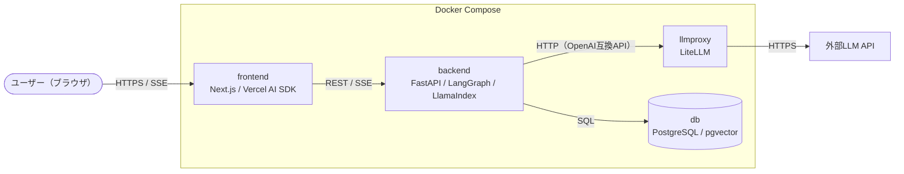
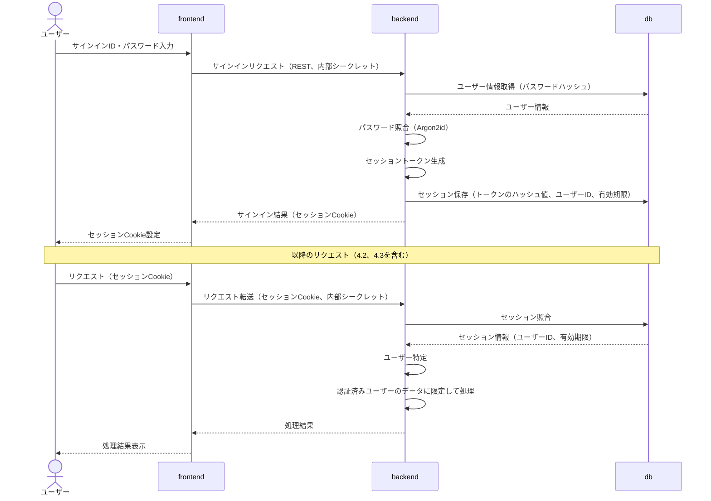
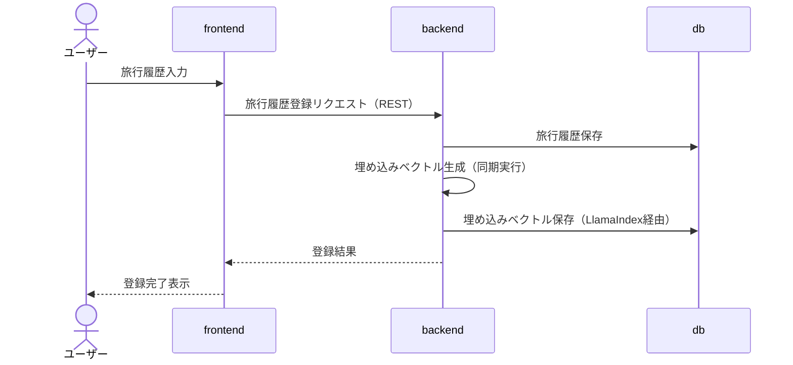
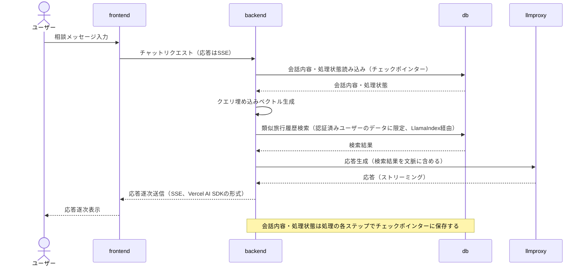

# アーキテクチャ

## 1. システム構成図

## 2. コンポーネント一覧

| コンポーネント | コンテナ | 責務 | 依存先 |
|---|---|---|---|
| フロントエンド | frontend | ・画面表示・入力受付（旅行履歴、チャット、アカウント登録・サインイン） ・ストリーミング応答の逐次表示 ・backendへのリクエスト転送（サーバー側） | backend |
| バックエンド | backend | ・Web API（REST・SSE）の提供 ・リクエスト元の検証（内部シークレット） ・ユーザー認証（パスワード照合、セッションの発行・検証・無効化） ・旅行履歴の登録・参照 ・埋め込みベクトルの生成 ・RAG検索 ・エージェント処理 ・LLM API呼び出し（llmproxy経由） ・会話履歴・エージェントの処理状態の保存・参照 | db、llmproxy |
| LLMプロキシ | llmproxy | ・LLM API呼び出し（応答生成）の集約 ・利用モデルの切替 | 外部LLM API |
| データベース | db | ・アプリケーションデータの永続化 ・ベクトルの保存・類似度検索 | - |

各コンポーネントには、上記の責務以外の処理を実装しない。

以降、本ドキュメントでは各コンポーネントをコンテナ名（frontend、backend、llmproxy、db）で表記する。

## 3. 主要データ

| データ | 内容 | 管理 | ユーザー単位 |
|---|---|---|---|
| ユーザー | サインインID、パスワードハッシュ | アプリ側のテーブル（Alembic） | - |
| セッション | トークンのハッシュ値、有効期限 | アプリ側のテーブル（Alembic） | ○ |
| 旅行履歴 | 旅行の登録内容、埋め込みベクトルの生成状態 | アプリ側のテーブル（Alembic） | ○ |
| 埋め込みベクトル | 旅行履歴のベクトル、生成モデル | LlamaIndex（pgvector） | ○ |
| 会話メタ情報 | 会話ID、タイトル、作成日時 | アプリ側のテーブル（Alembic） | ○ |
| 会話内容・処理状態 | メッセージ、エージェントの状態 | LangGraphのチェックポインター | ○ |

## 4. 主要処理フロー

### 4.1 サインイン・認証済みリクエスト

### 4.2 旅行履歴の登録

### 4.3 旅行プランの相談（チャット）

## 5. 通信方式

TBD
<!-- 記述予定内容：
- 各経路（ブラウザ→frontend、frontend→backend、backend→llmproxy、backend→db）のプロトコル・データ形式
- backendのSSE出力形式（採用するVercel AI SDKのバージョンとプロトコル）
- 認証情報の受け渡し（内部シークレットのヘッダー名、セッションCookie名）
- エラーレスポンスの形式
-->

## 6. バックエンド内部構成

TBD
<!-- 記述予定内容：
- レイヤー構成（API層、サービス層、エージェント層（LangGraph）、検索層（LlamaIndex）、リポジトリ層（SQLModel））と依存の向き
- LlamaIndexはインデックス構築・検索（埋め込みベクトルの生成を含む）に限定し、応答生成・エージェント機能は使用しない
- Vercel AI SDK形式のアダプター、内部シークレット・セッション検証の配置
- エージェント処理フロー（LangGraphのノード構成・状態）の概要、または別ドキュメント（例：agent-design.md）へのリンク
- ディレクトリ構成の詳細は「ディレクトリ・ファイル構成（バックエンド）」に委ねる
-->

## 7. アーキテクチャ方針・制約

### 7.1 通信経路

- ブラウザ→frontend：開発環境を含め、HTTPSで通信する。
- backendの呼び出し：ブラウザから直接呼び出さず、frontend（サーバー側）を経由する。
- frontend（サーバー側）の処理：転送のみ行う。業務ロジック・形式変換は実装しない。
- ブラウザからのリクエスト：Next.jsのproxy（`proxy.ts`）でbackendへrewriteする。セッションCookieはそのまま中継する。
- proxyの適用対象：backendへの転送パスに限定する。
- Server Components・Server Actionsからの呼び出し：サーバー専用のbackend呼び出しモジュールを使用する。
- 公開ポート：各コンテナのWSL 2内での公開ポートを`.env`で指定する。
- 外部LLMへの送信データ：相談メッセージ、会話履歴、検索した旅行履歴を、応答生成の文脈として外部LLM APIに送信する。

### 7.2 コンポーネント間認証

- frontend→backend：Docker Composeのシークレットで共有する内部シークレットをヘッダーに付与する。
  - 付与箇所：proxy、サーバー専用のbackend呼び出しモジュール。
  - proxyは同ヘッダーを常に上書きする（ブラウザから送られた同名ヘッダーは使用しない）。
  - 読み込み：共通の設定モジュールに集約する。
  - 検証：backendは定数時間比較で検証し（タイミング攻撃対策）、不一致は拒否する。
- backend→llmproxy：LiteLLMのマスターキーを付与する。
- backend→db：DBのユーザー名・パスワードで認証する。パスワードはDocker Composeのシークレットで共有する。

### 7.3 ユーザー認証

- 認証処理（パスワード照合、セッションの発行・検証・無効化）：backendで行う。
- frontend：認証ライブラリを導入しない。
- アカウント登録：誰でも登録できる（招待制・管理者承認は設けない）。
- サインインID：ユーザーごとに一意とする。メールアドレスの確認は行わない。
- パスワードリセット：メール送信機能を持たないため、提供しない。
- アカウント削除：ユーザー自身で削除できる。関連する旅行履歴・会話・セッションも削除する。
- パスワード：Argon2idでハッシュ化して保存する。平文を保存しない。ブラウザ側ではハッシュ化しない。
- サインイン失敗時のメッセージ：サインインID・パスワードのどちらの誤りかを区別しない。
- サインインの試行回数：サインインID単位で制限する（回数・ロック時間は未定）。
- セッション：DBで管理する。トークンは推測できない乱数で生成し、DBにはハッシュ値を保存する。
- セッションCookie：HttpOnly・Secure・SameSite=Laxとする。
- セッションの有効期限：当面は`.env`の暫定値とする。期限切れのセッションは照合時に無効とし、削除する。
- セッションの削除：サインアウト時は該当セッション、パスワード変更時は当該ユーザーの全セッションを削除する。
- データの参照範囲：旅行履歴・会話履歴はユーザー単位で管理する。参照・検索（RAG検索を含む）は認証済みユーザー自身のデータに限定する。
- データを変更するリクエスト（CSRF対策）：backendでOriginヘッダーを検証する。サーバー専用のbackend呼び出しモジュールは、ブラウザから受けたOriginヘッダーを中継する。

### 7.4 ストリーミング応答

- 出力形式：backendはVercel AI SDKの形式（SSE）で出力する。
- 形式変換：backend内のアダプターに集約する。業務ロジック・エージェント処理はVercel AI SDKの形式に依存させない。
- Vercel AI SDKの更新時：プロトコル仕様の変更を確認し、アダプターも更新する。
- frontendでの転送時：バッファリングせず、逐次転送する。

### 7.5 埋め込みベクトルの生成

- 呼び出し：LlamaIndexの埋め込みモデルの抽象化を介する。呼び出し元はモデル・実行場所に依存させない（将来の外部API利用に備える）。
- 処理単位：旅行履歴の保存と埋め込みベクトルの生成を分ける（将来の非同期化に備え、生成のみ切り出せるようにする）。
- 冪等性：同一の旅行履歴に再実行しても重複しないようにする（再実行・非同期化に備える）。
- 生成失敗時：旅行履歴の登録は成功として扱う。生成状態から失敗した旅行履歴を特定し、再実行で生成する。
- 生成モデルの識別情報：モデル変更時の再生成対象の特定に使う。
- モデル変更時：ベクトルの次元数が変わる場合は、DBの列定義の変更を伴う。

### 7.6 会話履歴の保存

- 会話内容・エージェントの処理状態：アプリ側のテーブルに重複して保存しない。
- 保存期間：会話はユーザーが削除するまで無期限とする。過去のチェックポイントは当面すべて保持する。
- 会話の削除時：チェックポインターとアプリ側のテーブルの両方から削除する。

### 7.7 ログ・エラー処理

- ログ出力先：各コンテナの標準出力とする。
- 出力しない情報：パスワード、セッショントークン、内部シークレット、APIキー、旅行履歴・会話内容の本文（デバッグ目的を含む）。
- ユーザーへのエラー表示：内部情報を含まない汎用的なメッセージとし、詳細はログに出力する。
- ストリーミング中のエラー：SSEでエラーを通知し、frontendで表示する。
