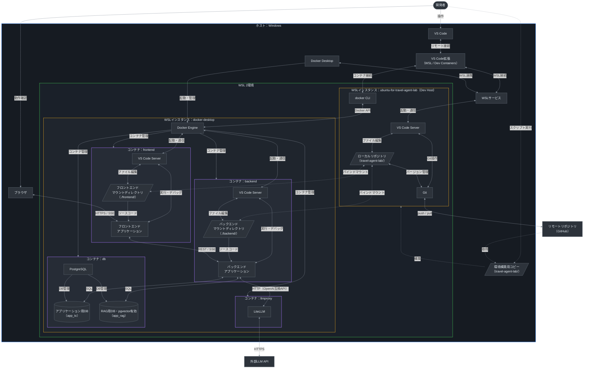

# 開発環境

## 1 開発環境構成図

- 凡例：実線＝操作・通信・管理、点線＝初回作業（環境構築）・バインドマウント
- 配色：ダークテーマ前提

## 2 環境構築の仕組み

TBD
<!-- 記述予定内容：
- 構築の流れ：環境構築用コピーの取得 → `bootstrap-dev-env-wsl.ps1`（Windows側） → `provision-dev-env.sh`・Ansible（WSL 2内） → ローカルリポジトリのクローン
- Windows側・WSL 2内それぞれの処理範囲
- Dev Hostの作成内容（ディストリビューション、既定ユーザー）
- Ansibleでプロビジョニングする内容（パッケージ、Git設定、docker CLI、AIコーディング支援ツール等）
- 冪等性の確保方法、再実行・再構築の方針
- 手順はREADME「3 開発環境利用手順」に委ねる。
-->

## 3 コンテナ構成

TBD
<!-- 記述予定内容：
- `compose.yaml`の各サービスのベースイメージ・起動コマンド
- サービス間の依存関係・起動順序（ヘルスチェック）
- ネットワーク構成、WSL 2内への公開ポート（値は`.env`で指定）
- ボリューム：バインドマウント、名前付きボリューム（`node_modules`、`.venv`、埋め込みモデルのキャッシュ等）
- `compose.devcontainer.yaml`による上書き内容（`compose.yaml`単体での起動との差異）
- コンテナ内ユーザー（UID・GID）とマウントファイルの権限
-->

## 4 Dev Container

TBD
<!-- 記述予定内容：
- frontend・backendのDev Container定義の方針（接続するサービス、ワークスペースフォルダー）
- コンテナ作成時の処理（依存パッケージのインストール等）
- VS Code拡張機能・エディタ設定（フォーマッタ、リンター）
- Dev HostとDev Containerの作業の使い分け（Git操作、コンテナ操作、コード編集）
- デバッグ・テストの実行構成（`.vscode/`の`launch.json`・`tasks.json`）
-->

## 5 設定値・機密情報の管理

TBD
<!-- 記述予定内容：
- `.env`で管理する設定項目の分類（ポート、接続先LLM、セッション有効期限等）
- Docker Composeのシークレットで管理する値（内部シークレット、DBパスワード、LiteLLMマスターキー、LLM APIキー）とファイルの配置場所・生成方法
- 機密情報をリポジトリ・生成AIへの入力に含めないための設定（`.gitignore`、生成AIツールの読み取り除外設定）
-->

## 6 HTTPS化

TBD
<!-- 記述予定内容：
- 開発用証明書の発行方法・保存先
- Windows側ブラウザでの信頼設定
- 証明書の更新・再発行
-->

## 7 データの永続化・初期化

TBD
<!-- 記述予定内容：
- DBデータの保存先、バックアップの保存先（`data/`）
- DBの初期化（`app_tx`・`app_rag`の作成、pgvectorの有効化、マイグレーションの実行タイミング）
- バックアップ・リストア、環境リセットの方法
-->

## 8 AIコーディング支援の実行環境

TBD
<!-- 記述予定内容：
- Claude Code・GitHub Copilotの実行場所（Dev Host・Dev Container）と認証方法
- 生成AIへの指示・ルールファイル（AGENTS.md、CLAUDE.md等）の配置
- Issue起点の実装を実行する環境（GitHub上の実行基盤、権限設定）
-->

## 9 開発環境方針・制約

TBD
<!-- 記述予定内容：
- Windowsに導入するソフトウェアは最小限とし、開発ツールはDev Host・コンテナ内に置く。
- ローカルリポジトリはWSL 2のファイルシステム上に置く。
- 改行コード・文字コードの統一方法
- WSL 2のリソース上限（`.wslconfig`）
- Docker Desktopの前提設定（WSL連携の対象インスタンス）
- 前提ソフトウェアの最低バージョン（Windows、WSL、Docker Desktop、VS Code）
- 本章・2〜8章で新たに必要となるファイル（シークレット、証明書、`.gitattributes`等）は「ディレクトリ・ファイル構成」にも反映する。
-->
